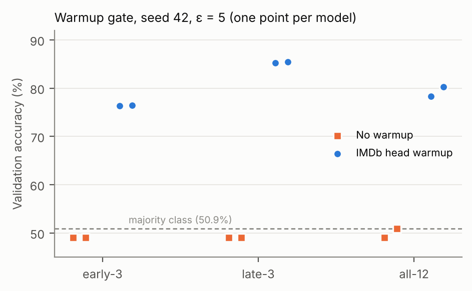
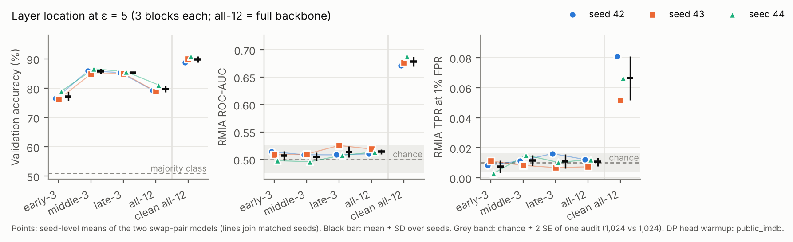
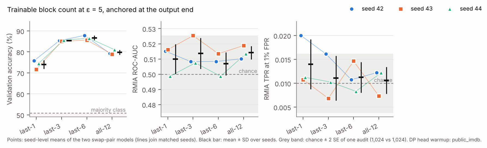
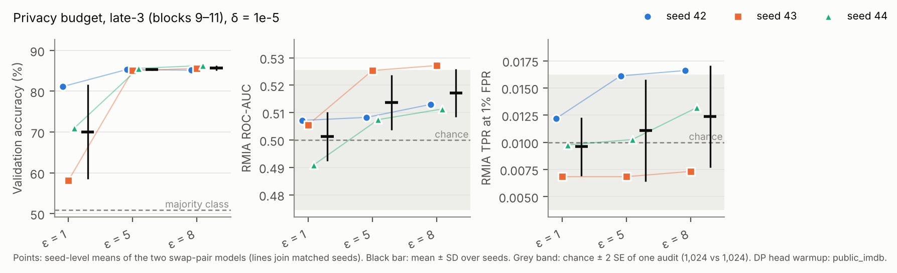
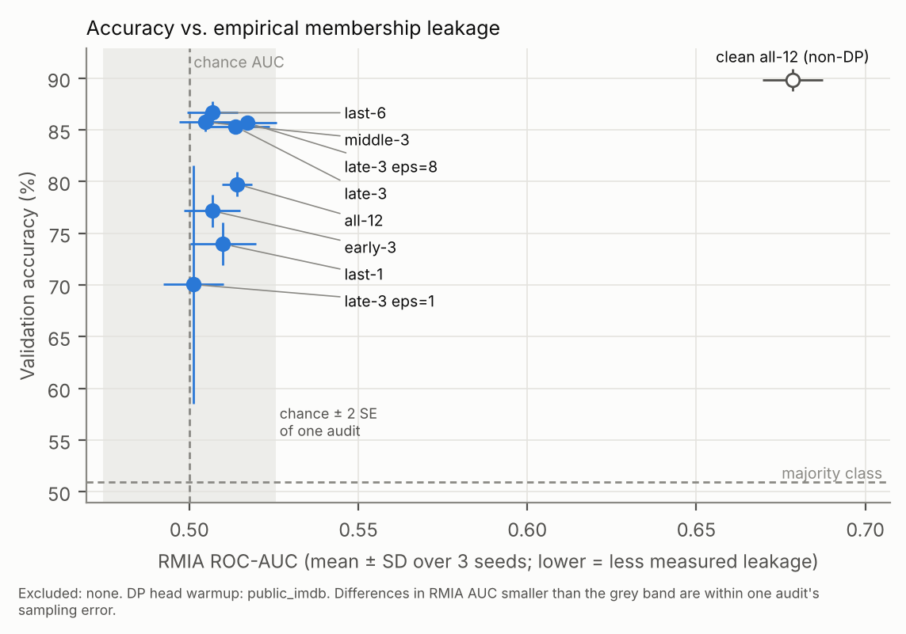

# Privacy–Utility Trade-off in Differentially Private LLM Fine-Tuning

**Which transformer layers should you fine-tune under differential privacy, and how many?**
This project fine-tunes selected blocks of `roberta-base` on SST-2 with DP-SGD (Opacus) and measures
two things for every configuration: validation accuracy, and empirical membership leakage under an
RMIA membership-inference attack, kept separate from the formal (ε, δ) guarantee.

*Hardware-Aware Deep Learning (Sem VII), IIT Guwahati.*
*Team: G Jayagiri · Vasudev Krishna · Uditya Shekhawat · Pranav Vishal Deshmukh · Arkaprava Paul · Harshit Goel*

> **Status (November 2026):** the corrected three-seed core grid is complete: 27 swap pairs (54 models),
> all of which passed validation. Results are in [`results/grid/`](results/grid/) and written up in
> [`report.tex`](report.tex) (compiled PDF: [`reports_c/report_final.pdf`](reports_c/report_final.pdf);
> standalone LaTeX package: [`report_latex.zip`](report_latex.zip)).

---

## Key results

Validation accuracy on SST-2 (mean ± SD over seeds 42, 43, 44; each seed's value is the mean of its two
swap-pair models). RMIA AUC of 0.5 means the attack ranks members no better than chance.

| Configuration | Trainable blocks (+ head) | Trainable params | ε (target) | Val. accuracy (%) | RMIA ROC-AUC | TPR @ 1% FPR |
|---|---|---:|:-:|:-:|:-:|:-:|
| Clean (no DP) | all 12 | 68.7% | ∞ | **89.9 ± 1.1** | **0.679 ± 0.009** | **0.066** |
| early-3 | 0, 1, 2 | 17.5% | 5 | 77.2 ± 1.5 | 0.507 ± 0.008 | 0.007 |
| middle-3 | 4, 5, 6 | 17.5% | 5 | 85.8 ± 0.9 | 0.505 ± 0.008 | 0.012 |
| late-3 | 9, 10, 11 | 17.5% | 5 | 85.3 ± 0.3 | 0.514 ± 0.010 | 0.011 |
| all-12 | 0–11 | 68.7% | 5 | 79.8 ± 1.2 | 0.514 ± 0.004 | 0.011 |
| last-1 | 11 | 6.2% | 5 | 74.0 ± 2.1 | 0.510 ± 0.010 | 0.014 |
| last-6 | 6–11 | 34.6% | 5 | 86.7 ± 1.1 | 0.507 ± 0.008 | 0.011 |
| late-3 | 9, 10, 11 | 17.5% | 1 | 70.0 ± 11.6 | 0.501 ± 0.009 | 0.010 |
| late-3 | 9, 10, 11 | 17.5% | 8 | 85.7 ± 0.6 | 0.517 ± 0.009 | 0.012 |

All DP runs use δ = 1e-5; accounted ε is 0.993 / 4.993 / 7.991 for targets 1 / 5 / 8.
Per-seed values: [`results/grid/analysis/summary.csv`](results/grid/analysis/summary.csv).
Matched-seed differences: [`matched_diffs.csv`](results/grid/analysis/matched_diffs.csv).

**What the grid shows** ("3/3" = same direction in all three seeds; differences are against late-3 at ε = 5):

1. **Where you fine-tune matters more than how much.** early-3 (−8.1 pts, 3/3), last-1 (−11.4, 3/3) and
   all-12 (−5.6, 3/3) are all worse than late-3, even though all-12 trains 4× more parameters.
   middle-3 (+0.4) and last-6 (+1.3, 3/3, small) are as good or slightly better. Accuracy is **not**
   monotonic in the number of trainable parameters.
2. **Privacy budget.** ε = 1 costs a lot and is unstable for this 300-step recipe (81 / 58 / 71% across
   seeds). ε = 8 gives no resolved gain over ε = 5.
3. **Empirical leakage.** The same RMIA attack clearly detects membership in the non-private model
   (TPR at 1% FPR ≈ 6.6× chance). Under every DP configuration it falls to near chance (AUC 0.50–0.52).
   The audit **cannot rank DP configurations against each other**: their differences are smaller than one
   audit's sampling error (±0.026 AUC at 2 SE with 1,024 members vs 1,024 non-members).
4. **A warmup is needed.** Without a classifier-head warmup, every DP model collapsed to predicting one
   class. A 100-step warmup on *public* IMDb reviews fixes this at no privacy cost.

Near-chance RMIA AUC describes this attack under this setup. It is consistent with the formal DP
guarantee but is not evidence for it; the guarantee is stated separately (see
[Privacy accounting](#privacy-accounting-what-ε-covers)).

## Figures

All figures are regenerated from the per-model records (see [Reproducing](#reproducing-the-results)).
Grey bands in the RMIA panels show chance ± 2 SE of a single audit.

**Warmup gate:** without warmup every model predicts a single class; with the public IMDb warmup all learn.



**Layer location at ε = 5** (three blocks each; all-12 = full backbone; clean baseline for context):



**Number of trainable blocks at ε = 5**, anchored at the output end:



**Privacy budget** (late-3; ε = 1, 5, 8):



**Accuracy vs. measured leakage** (configurations with 3 valid seeds and no collapsed model):



---

## What changed in the second half

The midterm **pilot** (one seed) warmed the classifier head up for 100 non-private steps **on the private
training split** before Opacus started accounting. Those steps weren't covered by the accountant, so the
pilot's "ε = 5" was not an end-to-end guarantee. The second half fixed this and reran everything properly:

| | Pilot (midterm) | Corrected grid (this README) |
|---|---|---|
| Head warmup | 100 steps on **private** SST-2 split, unaccounted | none, or 100 steps on **public** IMDb (used) |
| Accounting order | not checked | enforced at run time: private data can't be read before the accountant is attached |
| Seeds | 42 only | 42, 43, 44 with matched partitions per seed |
| Validation of results | none | shared acceptance rule (ε ≤ target, accounting checks, matching partition hashes, finite metrics, full step count) |
| Records | CSV rows | one JSON record per model with every setting and metric |

The pilot CSVs in `results/*.csv` are kept unchanged as historical pilot results and are not mixed with the
corrected grid.

## Method

**Model.** `roberta-base` (12 encoder blocks, 124.6M parameters). Embeddings are always frozen; the
classification head (592k parameters) always trains, plus the selected blocks.

**Data.** GLUE SST-2. The training set is de-duplicated (normalized text, conflicting labels removed);
SST-2 phrases contained in a longer sentence are grouped into a "family", and at most one item per family
is used in any split. It is then split per seed into disjoint parts:

| Split | Size | Role |
|---|---:|---|
| D_A | 1,024 | private training set of model M_A |
| D_B | 1,024 | private training set of model M_B |
| D_out | 1,024 | non-members for the audit |
| D_pop | 1,024 | population data for RMIA calibration |
| D_tune | 2,048 | reserved for the (pilot) layer-selection step |

Validation accuracy is measured on the GLUE SST-2 validation set (872 examples; majority class 50.92%).
Partitions are deterministic per seed and recorded in `manifests/manifest_seed{42,43,44}.json`.

**Swap-pair audit.** For each (configuration, seed), two models are trained: M_A on D_A and M_B on D_B.
Each is audited with offline RMIA using the other as its reference model (members = its own training split,
non-members = D_out). Both models are reported and averaged within the seed.

**DP training (shared by all DP configurations).** Opacus DP-SGD with Poisson sampling; logical batch 64
(q = 1/16), physical batch 16, 300 steps, clipping C = 1.0, δ = 1e-5, RDP accountant; AdamW, backbone LR
1e-3, head LR 3e-3, weight decay 0, linear schedule with 5% LR warmup; max sequence length 128.
Head warmup: 100 non-private AdamW steps (LR 1e-3) on a seeded, class-balanced sample of 4,096 IMDb
reviews, identical for every configuration within a seed. The **clean baseline** keeps its own recipe
(LR 3e-5, 1,000 steps, no DP, no warmup) and is shown for context only.

**Acceptance rule** ([`src/record_validation.py`](src/record_validation.py)). One rule is applied when a
record is written, when the runner decides what to resume, and when the analysis selects pairs. A swap pair
counts only if both models finished the configured steps (300 DP / 1,000 clean), have finite metrics and a
nonempty partition hash, both hashes match each other and the seed's manifest, and (for DP) the accounted
ε is finite and ≤ target and both accounting checks passed. Anything else is listed with its reason, rerun
on resume, and excluded from the statistics.

**Analysis.** Seed value = mean of the two swap-pair models; configurations are summarised by mean ± sample
SD over the 3 seeds, with every seed shown. Comparisons use matched seeds (difference to late-3 per seed).
A difference is called *repeated* only if it has the same sign in all three seeds; 95% *t*-intervals
(df = 2) are saved but are wide, and no significance claims are made.

### Privacy accounting: what ε covers

The guarantee is per model: M_A is (ε, δ)-DP with respect to D_A (and M_B with respect to D_B), under
add/remove-one adjacency, Poisson sampling and the Opacus RDP accountant.

| Stage | Covered? |
|---|---|
| DP-SGD fine-tuning on D_A / D_B | **Yes**, accounted ε saved per model |
| Head warmup on public IMDb | Not needed (public data; assumes IMDb is disjoint from the private records) |
| Pretrained weights, random head init | Not needed (public / data-independent) |
| Opacus empty-batch shape probe (reads one example's tensor shape; feeds no update) | Not covered; logged per run (exactly 2 reads) |
| De-duplication and partitioning of SST-2 | Not covered; guarantee is stated for D_A as given |
| **Hyperparameters and the warmup decision** (chosen from seed-42 runs and the validation set) | **Not covered**: the main remaining gap |
| Automatic layer selection (DP-SelFT pilot) | Not in the core grid; its proxy labels are not privatized |

Every DP record stores an accounting ledger proving the accountant was attached before the first private
read and that accountant steps equal optimizer steps. An independent integer-order RDP implementation
([`scripts/rdp_crosscheck.py`](scripts/rdp_crosscheck.py)) reproduces the logged ε to within 2%.

### Grid design

9 configurations × 3 seeds × 2 models = **54 models**, defined in one place
([`scripts/grid_spec.py`](scripts/grid_spec.py)):

| Comparison | Arms | Fixed |
|---|---|---|
| Layer location | early-3 (0–2), middle-3 (4–6), late-3 (9–11), all-12; clean all-12 for context | ε = 5 |
| Privacy budget | late-3 at ε = 1, 5, 8 | layers, δ |
| Block count | last-1, last-3, last-6, all-12 (anchored at the output end) | ε = 5 |

late-3 at ε = 5 and all-12 are shared between comparisons rather than trained twice.

---

## Repository layout

```text
privacy-llm-finetuning/
├── run_experiment.py            # trains one swap pair (M_A, M_B), audits it, writes JSON records
├── src/
│   ├── train.py                 # DP-SGD training, public warmup, accounting-order checks
│   ├── privacy_guard.py         # ledger: blocks private reads before the accountant is attached
│   ├── record_validation.py     # the shared acceptance rule
│   ├── worker_utils.py          # never hang on a crashed training worker
│   ├── public_warmup.py         # IMDb warmup data (public)
│   ├── data.py                  # SST-2 cleaning, deterministic per-seed partitions, manifests
│   ├── models.py                # layer freezing, trainable-parameter accounting
│   ├── audit.py                 # loss attack + offline RMIA, ROC-AUC, TPR at low FPR
│   ├── dp_proxy.py, select_layers.py   # DP-SelFT-style layer selection (pilot only)
├── scripts/
│   ├── grid_spec.py             # the 9 configurations, seeds, shared training recipe
│   ├── run_core_grid.py         # stages: smoke -> gate -> validate -> grid (resumable)
│   ├── grid_records.py          # record loading, collapse rule, gate decision
│   ├── aggregate_grid.py        # tables, matched differences, figures, runtime estimate
│   ├── plot_warmup_gate.py      # warmup-gate figure
│   └── rdp_crosscheck.py        # independent RDP accountant (numpy only)
├── kaggle_runner/
│   ├── kaggle_notebook_cell.py  # the exact Kaggle cell that produced results/grid
│   └── run_grid.py, run_on_kaggle.py, kernel-metadata.json   # older launchers (pilot era)
├── configs/
│   ├── grid/                    # generated YAML for every grid configuration (both warmup variants)
│   └── *.yaml                   # pilot configurations (private warmup removed)
├── manifests/manifest_seed{42,43,44}.json   # exact partitions per seed
├── results/
│   ├── grid/                    # CORRECTED GRID
│   │   ├── records/             # 60 per-model JSON records (54 grid + 6 no-warmup gate)
│   │   ├── analysis/            # summary.csv, seed_level.csv, matched_diffs.csv, figures, table_core.tex
│   │   ├── logits/, logs/       # cached logits and training logs per model
│   │   ├── smoke/               # smoke-test result
│   │   └── warmup_decision_{none,public_imdb}.json
│   └── *.csv, empirical_analysis.md   # pilot results (historical, unchanged)
├── tests/                       # 34 CPU-only tests (no GPU or model download needed)
├── report.tex                   # report (midterm + corrected method + results)
├── report_latex.zip             # standalone LaTeX package (main.tex + figures + table)
├── reports_c/                   # compiled PDFs
├── RESULTS_PENDING.md           # how the grid was run, stage by stage
└── docs/, methodology_audit*.md, tasks/   # design notes and earlier audits
```

## Reproducing the results

### Install

```bash
git clone https://github.com/Victorvkk38596/privacy-llm-finetuning.git
cd privacy-llm-finetuning
python -m venv .venv && source .venv/bin/activate      # Windows: .venv\Scripts\activate
pip install -r requirements.txt matplotlib pytest
```

### Run the tests (CPU only, a few seconds)

```bash
python -m pytest -q tests/
```

These cover the accounting-order ledger, the acceptance rule (including a regression test for a pair with
mismatched partition hashes and ε above target that was once mislabelled valid), worker-crash handling,
stage wiring, and the analysis on synthetic records.

### Regenerate tables, figures and the report from the saved records (no GPU)

```bash
python scripts/aggregate_grid.py --records results/grid/records --out results/grid/analysis --warmup public_imdb
python scripts/plot_warmup_gate.py --records results/grid/records --out results/grid/analysis
python scripts/rdp_crosscheck.py
pdflatex report.tex && pdflatex report.tex
```

### Re-run the training grid (GPU)

The grid was run on Kaggle (one Tesla T4, ~4.3 h, one background job) with
[`kaggle_runner/kaggle_notebook_cell.py`](kaggle_runner/kaggle_notebook_cell.py):

1. New Kaggle notebook → Session options: **Accelerator = GPU T4**, **Internet = On**.
2. Paste the file's contents as the only cell.
3. **Save Version → Save & Run All (Commit)** (not the interactive Run button).
4. Download the `grid` output folder into `results/grid/`.

Locally or on any GPU machine, the same stages run with:

```bash
python scripts/run_core_grid.py --stage smoke
python scripts/run_core_grid.py --stage gate --warmup public_imdb
python scripts/run_core_grid.py --stage validate --warmup public_imdb
python scripts/run_core_grid.py --stage grid --warmup public_imdb
python scripts/run_core_grid.py --stage grid --warmup public_imdb --plan   # list what is still pending
```

Each stage skips swap pairs that already have valid records. Measured time per swap pair on a T4:
4.7 min (last-1), 6.6–7.3 min (3 blocks), 9.5 min (last-6), 13.5 min (clean), 15.3 min (all-12).

A single swap pair can also be run directly:

```bash
python run_experiment.py --config configs/grid/dp_late3_e5__w-public_imdb.yaml --seed 43
```

### Software used for the reported runs

Python 3.13, torch 2.11 (CUDA 13.0), transformers 5.20, Opacus 1.6.0, datasets 4.8, numpy 2.1,
scikit-learn 1.6; code at commit `04424d3` (stored in every record as `env.git_commit`).

## Per-model record format

Each file in `results/grid/records/` (`<config>__w-<warmup>__seed<N>__<M_A|M_B>.json`) contains:
seed, swap-pair role, training split, partition hash and manifest path; trainable blocks and per-group
parameter counts; all training settings (LRs, steps, batch sizes, clipping, warmup source and data
fingerprint); target ε and δ, accounted ε, noise multiplier, sample rate and the accounting ledger;
validation accuracy and predicted-positive rate; loss-attack and RMIA metrics (ROC-AUC, TPR at 1% / 5%
FPR); clip fraction, runtime, package versions and git commit; and a `status` with reasons if invalid.

## Limitations

- **Hyperparameters and the warmup decision were chosen using private data** (seed-42 runs and the same
  validation set used for reporting); the accountant does not cover these choices.
- **Three seeds** give a rough view of variability, not precise estimates.
- **One attack.** Offline RMIA with a single reference model is a fairly weak attacker; near-chance AUC
  does not rule out leakage to stronger attacks (more reference models, canaries).
- **Fixed recipe across budgets.** The ε = 1 instability describes this 300-step recipe at σ ≈ 4.6, not DP
  at ε = 1 in general.
- **Clean baseline** uses a different recipe and is context only. **middle-3** uses the repository's
  existing definition (blocks 4–6), which is not exactly centred.
- **Not supported by these results:** that one DP configuration leaks less than another; that
  trainable-parameter count alone predicts accuracy or leakage; anything about other models, datasets or
  attacks.

## Not in scope yet

Automatic DP layer selection (DP-SelFT, kept as a pilot result because its proxy-label step is not
privatized), LoRA, canary-based extraction tests, and a second dataset.

## Pilot results (historical)

The midterm pilot (seed 42 only, with the unaccounted private-split warmup) reported late-3 84.8%,
all-12 81.0%, early-3 72.2% at ε = 5. These numbers are kept in `results/*.csv` and in the report's
midterm section for reference only. The corrected seed-42 values (85.3 / 79.3 / 76.4%) preserve the
ordering, with a smaller early-3 gap.

## Acknowledgements

Built on RoBERTa (Liu et al., 2019), DP-SGD (Abadi et al., 2016), Opacus, the GLUE SST-2 and IMDb (Maas
et al., 2011) datasets, and RMIA (Zarifzadeh et al., 2024).
